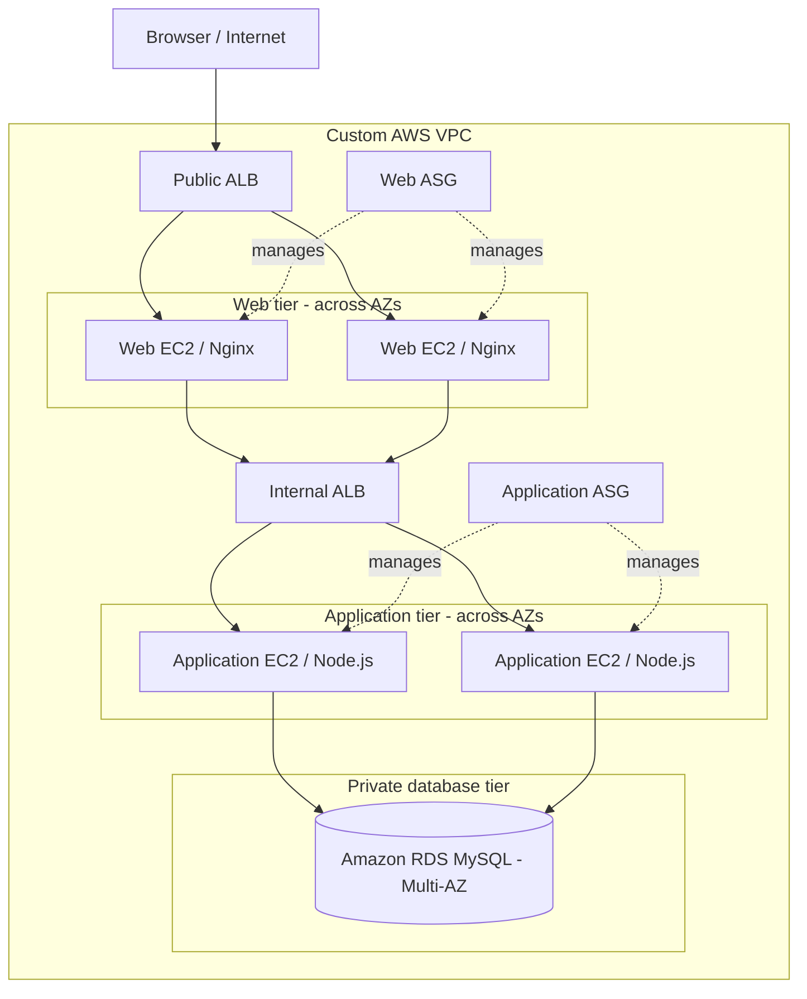
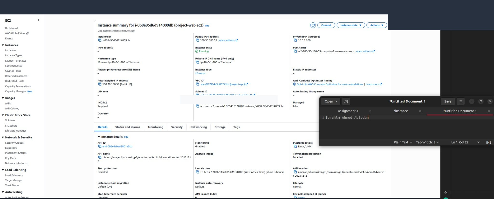
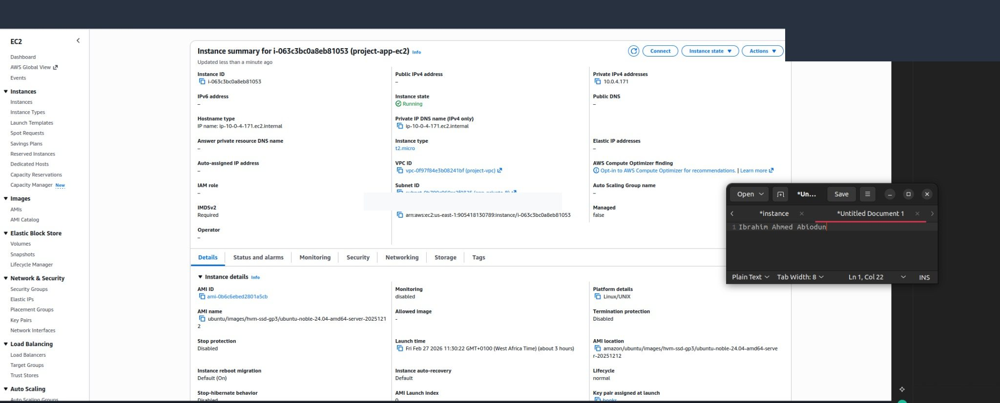
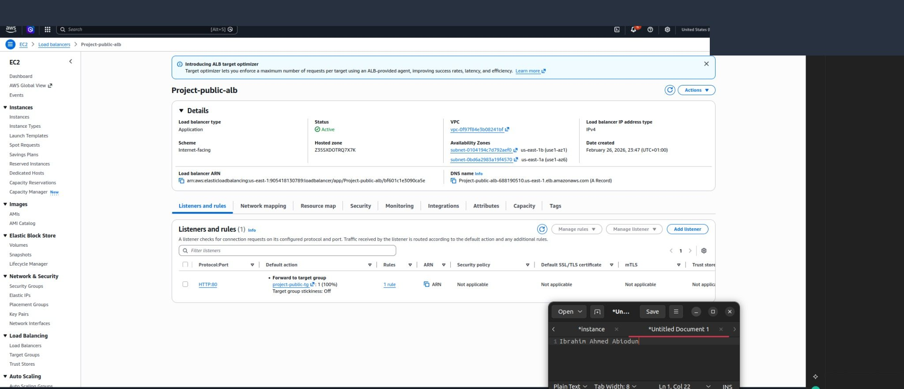
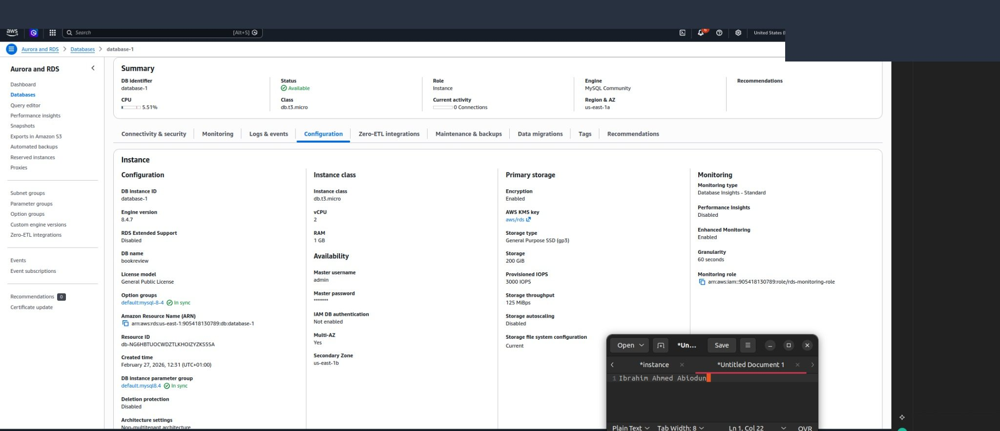
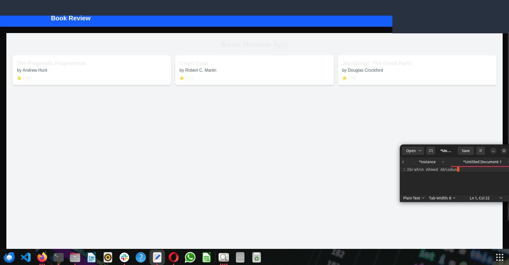

# AWS Three-Tier Book Review Application Architecture

**High availability · Network segmentation · Public/Internal ALBs · Auto Scaling · Amazon RDS**

This repository documents my **AWS three-tier capstone** completed during **DevOps Micro Internship (DMI), Cohort 2 — Week 6** (submission: **27 February 2026**). I configured a separately routed **web tier**, **application tier**, and **database tier**, then tested the Book Review application's request flow and troubleshot communication between layers.

> **Scope:** Training infrastructure built and tested on AWS. This repository is an **architecture and operations case study**, not an infrastructure-as-code implementation or a production-hardened service. Screenshots reflect the historical lab, not a currently hosted endpoint.

## Architecture

**Verified request path described in the submission:**

`Internet → Public ALB → Web EC2/Nginx → Internal ALB → App EC2/Node.js → RDS MySQL`

## Technology stack

| Layer | Technology / responsibility |
| --- | --- |
| Network | AWS VPC, public/private subnets, route tables, Internet and NAT gateways |
| Public routing | Internet-facing Application Load Balancer (`project-public-alb`) |
| Web tier | EC2 instances, Nginx reverse proxy, web Auto Scaling Group (`web-asg`) |
| Internal routing | Internal Application Load Balancer (`project-internal-alb`) |
| Application tier | EC2, Node.js/npm, application Auto Scaling Group (`project-app-asg`) |
| Data tier | Private Amazon RDS MySQL with Multi-AZ enabled |
| Security | Security groups scoped to traffic between tiers |
| Diagnostics | SSH, Linux CLI, `curl`, `nginx -t`, package/network tests |

## Work completed

### 1. Design and configure segmented infrastructure

I configured a VPC with public and private subnets, separate web/application infrastructure, an internet-facing ALB and an internal ALB. The deployed application was intended to avoid exposing the application/database tiers as direct public entry points.

The following screenshots show the **web** and **application** EC2 resources recorded in my submission.

### 2. Configure external and internal load balancing

I used a **public-facing ALB** to reach the web tier and an **internal ALB** to forward traffic to the application tier. I documented Auto Scaling Groups for both tiers and verified target configuration and HTTP routing.

### 3. Integrate a private database

I deployed Amazon RDS MySQL, configured database access through the application tier's security group, and checked the application-to-database connection. The source assignment describes **Multi-AZ**; although an evidence heading mentions a replica, I have **not** claimed that a read replica was independently verified.

### 4. Verify the Book Review application

The application was accessible through the public entry point and displayed the Book Review interface.

## Troubleshooting performed

| Issue | Diagnosis / reported resolution |
| --- | --- |
| `nginx -t`: unknown directive | Found hidden non-breaking spaces introduced by copy-paste; inspected with `cat -A`, rewrote config and validated syntax. |
| `npm install` stalled around `sharp` | Cleared dependency install state, reinstalled, and checked Node.js compatibility. |
| Application could not reach RDS | Corrected DB security-group source to the application SG and checked database endpoint in configuration. |
| ALB targets unhealthy | Validated the target port (the report references **3001** for the app), health-check path and backend process. |

Further steps are in [docs/troubleshooting.md](docs/troubleshooting.md).

## Outcome

- Demonstrated a multi-tier AWS request path with **public and internal load balancing**.
- Configured distinct security boundaries across web, application and RDS layers.
- Validated the application interface and diagnosed web proxy, dependency, database and target-health issues.

### Limitations

The report does not establish CI/CD automation, infrastructure-as-code, HTTPS, formally exercised AZ-wide failover for this specific capstone, or a verified read-replica configuration. Only configuration excerpts and procedures supported by the report are documented; no actual deployment secrets are included.

**Evidence:** Selected screenshots from pages 65–67 of the original Week 6 submission. Top AWS/browser account banners were masked. The public ALB endpoint shown in the original report is a **historical endpoint**, not a live-demo promise.

## Skills demonstrated

`AWS` · `3-Tier Architecture` · `VPC` · `EC2` · `ALB` · `Internal Load Balancer` · `Auto Scaling` · `Nginx` · `Node.js` · `RDS MySQL` · `Linux` · `Network Security` · `Troubleshooting`

## Author

**Ibrahim Ahmed Abiodun**  
GitHub: [@slim274](https://github.com/slim274)  
**Training:** DevOps Micro Internship — Cohort 2, Week 6, Assignment 4
